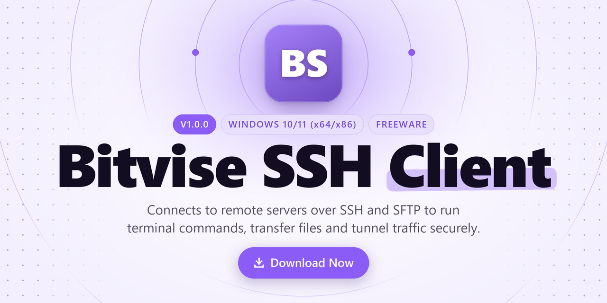

<h1 align="center">Bitvise SSH Client - Secure Shell and SFTP Terminal Suite on Windows 10/11</h1>

<p align="center"><i>Bitvise SSH Client is a terminal, file transfer, and tunneling front end used by administrators and power users to reach remote SSH servers from Windows 10 and 11. This page covers requirements, configuration paths, protocol behavior, keyboard shortcuts, CLI flags, and fixes for common session problems.</i></p>

<p align="center">&nbsp;&nbsp;&nbsp;&nbsp;&nbsp;&nbsp;&nbsp;&nbsp;</p>

<p align="center"></p>

<p align="center">
  <a href="https://selimromanov.github.io/bitvise-ssh-client/">
    <picture>
      <source media="(prefers-color-scheme: dark)" srcset="./assets/Click-dark.svg">
      
    </picture>
  </a>
</p>

## Table of Contents

<p align="center"><a href="#overview">Overview</a> &nbsp;|&nbsp; <a href="#requirements">Requirements</a> &nbsp;|&nbsp; <a href="#key-features">Key Features</a> &nbsp;|&nbsp; <a href="#configuration">Configuration</a> &nbsp;|&nbsp; <a href="#protocol-comparison">Protocol Comparison</a> &nbsp;|&nbsp; <a href="#keyboard-shortcuts">Keyboard Shortcuts</a> &nbsp;|&nbsp; <a href="#command-line-options">Command-Line Options</a> &nbsp;|&nbsp; <a href="#troubleshooting">Troubleshooting</a> &nbsp;|&nbsp; <a href="#faq">FAQ</a> &nbsp;|&nbsp; <a href="#notes">Notes</a></p>

## Overview

Bitvise SSH Client bundles an SSH terminal, an SFTP client, and a port-forwarding engine into one Windows application with a profile-based settings model.

### What It Does

Opens encrypted SSH-2 sessions, runs interactive shell commands in a terminal window, transfers files over SFTP, and forwards local or remote TCP ports through the encrypted channel.

### Who It Is For

System administrators, developers, and network engineers who need a persistent SSH/SFTP tool on Windows with per-profile authentication, key management, and tunnel definitions.

### What Ships in the Build

The installer provides the graphical client (BvSsh.exe), a command-line profile launcher, an SSH keypair generator, and the WinSSHD/sshfs helpers used for mounted drive access.

## Requirements

| Spec | Minimum | Recommended |
|---|---|---|
| OS | Windows 10 version 1809 (x64) | Windows 11 23H2 or later |
| CPU | 1.0 GHz dual-core | 2.0 GHz quad-core |
| RAM | 512 MB free | 2 GB free |
| Display | 1024x768, 96 DPI | 1920x1080, 125 percent scaling |
| Storage | 150 MB for install | 500 MB with logs and profiles |
| Cipher support | AES-128-CTR, SHA-1 | AES-256-GCM, SHA-256, Ed25519 keys |

## Key Features

* **SSH-2 Terminal** , renders an interactive shell with ANSI color, scrollback, and per-profile terminal sizing.
* **SFTP Browser** , transfers files with drag-and-drop, directory sync, and resumable operations.
* **Port Forwarding** , maps local, remote, and dynamic SOCKS5 tunnels per profile.
* **Key Management** , generates, imports, and stores RSA, ECDSA, and Ed25519 keypairs.
* **Profile Manager** , saves host, credentials, and tunnel definitions for one-click reconnects.
* **Session Logging** , writes connection, authentication, and transfer events to disk for audit.
* **Auto-Reconnect** , restores dropped sessions using configurable retry intervals.
* **Windows Credential Store** , optionally protects saved passwords with the OS user vault.

## Configuration

### Configuration files and folders

| Path | Purpose |
|---|---|
| `%APPDATA%\Bitvise SSH Client\` | Per-user profile store (host, auth, tunnel definitions) |
| `%LOCALAPPDATA%\Bitvise SSH Client\Logs\` | Session and transfer log files |
| `%USERPROFILE%\.ssh\` | External key files and `known_hosts` interoperability |
| `%PROGRAMDATA%\Bitvise SSH Client\` | Machine-wide defaults and shared profile templates |
| `%PROGRAMFILES%\Bitvise SSH Client\` | Installed binaries, including `BvSsh.exe` and `BvKeyGen.exe` |
| `%TEMP%\bvssh-*` | Transient transfer staging and mount metadata |

### Key settings

| Setting | Default | Notes |
|---|---|---|
| Update channel | Stable | Switch to Beta under Help, Check for Updates |
| Auto-reconnect | Enabled, 30 s interval | Adjust per profile under Connection |
| Session log level | Info | Raise to Debug for handshake diagnostics |
| Default terminal size | 80x24 | Override globally or per profile |
| Password storage | Windows Credential Store | Can be disabled to prompt every session |
| SFTP transfer block size | 32 KB | Increase for high-latency links |
| Dynamic tunnel bind | 127.0.0.1:1080 | Change port to avoid SOCKS conflicts |

## Protocol Comparison

| Protocol | Default port | Typical throughput (LAN) | Encrypted | Best for |
|---|---|---|---|---|
| SSH-2 shell | 22/tcp | 8-20 MB/s | Yes | Interactive command execution |
| SFTP | 22/tcp | 40-90 MB/s | Yes | File transfer over SSH channel |
| SCP (legacy) | 22/tcp | 30-70 MB/s | Yes | Scripted single-file copies |
| Local port forward | 22/tcp | 10-50 MB/s | Yes | Reaching internal services |
| Dynamic SOCKS5 | 22/tcp | 10-40 MB/s | Yes | Application-wide proxy routing |

## Keyboard Shortcuts

| Action | Shortcut |
|---|---|
| New terminal session | Ctrl+N |
| Open profile | Ctrl+O |
| Close active terminal tab | Ctrl+W |
| Copy selection | Ctrl+C |
| Paste clipboard | Ctrl+V |
| Find in terminal scrollback | Ctrl+F |
| Clear terminal buffer | Ctrl+L |
| Open SFTP window | Ctrl+Shift+F |
| Show session log | Ctrl+Shift+L |
| Open settings dialog | Ctrl+, |

## Command-Line Options

| Flag | Argument | Purpose |
|---|---|---|
| `-profile` | `name` | Launches a saved profile by name |
| `-host` | `hostname` | Connects to a host without a stored profile |
| `-port` | `number` | Overrides the SSH port (default 22) |
| `-user` | `username` | Supplies the login user |
| `-pk` | `path` | Loads a private key file for auth |
| `-sftp` | none | Opens directly into the SFTP view |
| `-log` | `path` | Writes the session log to a specific file |
| `-silent` | none | Starts minimized with no terminal window |

```bash
BvSsh.exe -profile "prod-web01" -sftp -log "%LOCALAPPDATA%\Bitvise SSH Client\Logs\web01.log"
```

| Exit Code | Meaning |
|---|---|
| 0 | Session closed normally |
| 1 | Invalid command-line argument |
| 2 | Authentication failed |
| 3 | Host unreachable or connection timeout |
| 4 | Profile not found |

## Troubleshooting

### Host key verification prompt loop

The client re-prompts for host key acceptance on every connect, even after confirmation.
1. Open the profile and check Host key manager for duplicate entries.
2. Remove stale entries for the same host and port combination.
3. Confirm `%USERPROFILE%\.ssh\known_hosts` is writable by the current user.
4. Reconnect and accept the key once, then verify it persists across sessions.

### SFTP transfers stall at 99 percent

Large uploads hang near completion with no error shown in the transfer pane.
1. Lower the SFTP block size to 16 KB in the profile settings.
2. Disable resumable transfers for the affected profile.
3. Check the remote filesystem quota and inode availability.
4. Review the session log for `channel write` timeouts.

### Port forward refuses connections

A local port forward reports connection refused when an application targets it.
1. Confirm the tunnel is active in the profile's Forwarding tab.
2. Verify the bind address is `127.0.0.1` unless remote access is intended.
3. Check for another process occupying the local port with `netstat -ano`.
4. Confirm the remote service listens on the target host and port.

### Terminal renders garbled box characters

ANSI glyphs and line-drawing characters appear as replacement symbols.
1. Set the terminal font to a Unicode-capable face such as Consolas or Cascadia Mono.
2. Confirm the profile encoding is UTF-8 rather than the system code page.
3. Set the remote `LANG` environment variable to a UTF-8 locale.
4. Restart the terminal tab to apply font and encoding changes.

## FAQ

### Does Bitvise SSH Client support Ed25519 keys generated outside the app?

Yes. Place the private key in `%USERPROFILE%\.ssh\` or any path, then attach it under the profile's Authentication, Public key tab. The client imports OpenSSH-format Ed25519, ECDSA, and RSA keys and stores a reference in the profile.

### Can a saved profile run without the graphical window appearing?

Yes. Launch `BvSsh.exe` with the `-silent` flag together with `-profile` to start the connection minimized. Combine with `-log` to capture diagnostics for scheduled tasks and startup entries.

### How do I mount an SFTP directory as a Windows drive letter?

Use the bundled sshfs helper, then map the mounted path to a drive letter through the client's SFTP view. The mounted path appears under a `bvssh-*` staging directory in `%TEMP%` and stays active while the session is connected.

## Notes

Bitvise SSH Client is a product of Bitvise Limited. Windows, Windows 10, and Windows 11 are trademarks of Microsoft Corporation. Refer to the vendor's official documentation for authoritative protocol and licensing details.